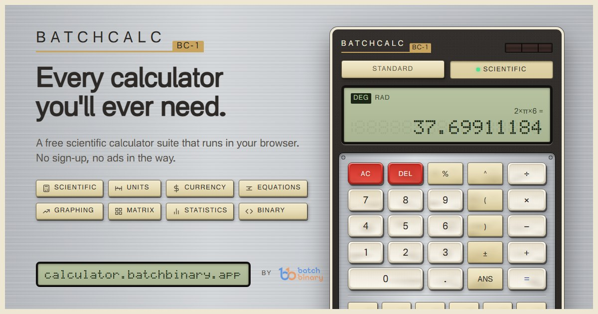

# BatchCalc

**Every calculator you'll ever need.** A free and open-source calculator suite that runs in your browser, with a scientific calculator plus seven other tools. No sign-up, no install, no build step.

**Use it:** https://calculator.batchbinary.app



## What's in it

| Tool | What it does |
|---|---|
| **Scientific** | Standard and Scientific modes. Trig (DEG/RAD), inverse and hyperbolic trig, logs, powers and roots, factorial, nCr/nPr, memory (MC, MR, M+, M−) and ANS. Like Google's calculator, the answer only appears when you press `=`. |
| **Units** | Length, mass, volume (UK and US), temperature, area, time, speed, data and energy. |
| **Currency** | 21 currencies. Daily rates from [open.er-api.com](https://open.er-api.com), cached, with built-in rates as a fallback when you're offline. |
| **Equations** | Linear, quadratic and cubic, including complex roots. |
| **Graphing** | Plot `y = f(x)`. Drag to pan, scroll to zoom. |
| **Matrix** | Add, subtract, multiply, transpose, determinant and inverse, up to 6×6. |
| **Statistics** | Mean, median, mode, range, population and sample variance/SD, plus linear regression for x,y data. |
| **Binary** | Decimal to binary with tap-to-toggle bits (8, 16 or 32-bit), and text to UTF-8 binary. |
| **History** | Searchable log of every sum, with notes. Tap one to recall it. |

The calculator also works from the keyboard: digits, `+ - * / ^ ( )`, `Enter` or `=`, `Backspace`, `Esc` to clear and `p` for π. It comes in English, Spanish, French, German, Welsh and Romanian, with light and dark themes.

## Try it on your computer

It's plain HTML, CSS and JavaScript, with no dependencies and nothing to install. Open `index.html` in your browser, or serve the folder with any static server:

```bash
python -m http.server 5173
```

Then open http://localhost:5173.

## The files

| File | What it is |
|---|---|
| `index.html` | The page and all of the app's JavaScript. |
| `styles.css` | The look, with both fonts embedded. |
| `share-card.jpg` | The picture shown when the link is shared. |
| `bb-logo.png` | Footer logo. |
| `favicon/` | Browser tab icons. |

## How it works

- **One page, many tools.** `index.html` holds a small state store, a hash router (`#/calc`, `#/graph`, …) and the translations. Each tool sits in its own commented section of the main `<script>`, and only the tool you're on is drawn.
- **Answers on `=`.** Like Google's calculator, the screen shows the sum as you type it, and the answer appears when you press `=`. Pressing an operator next carries on from the answer.
- **No `eval`.** Sums go through a hand-written shunting-yard parser (tokenise → postfix → evaluate). It handles implicit multiplication (`2π`, `3(4)`), unary minus (`-2^2 = -4`, `2^-3 = 0.125`), postfix factorial and DEG/RAD.
- **Saved in your browser.** History, notes, memory and settings are kept in `localStorage` under keys starting `bbcalc_`, so they're still there next time.
- **Currency rates.** Rates are fetched once a day from open.er-api.com and cached. When you're offline, the cache or the built-in rates are used instead.
- **Key wear.** Each key gets its own seeded smudge and yellowing, so the keypad looks used, and looks the same on every visit.

## Privacy

- No analytics, no tracking, no cookies.
- The only network request is the currency page fetching rates from open.er-api.com.
- Everything else stays in your browser.

## Contributing

Issues and pull requests are welcome. Keep it dependency-free and build-free, and check a change at phone width (375px) as well as on desktop.

## Licence

The code is licensed under [Creative Commons Attribution 4.0 International](LICENSE) (CC BY 4.0). You can use, change and share it, including commercially, as long as you credit **Batch Binary** and link back to https://calculator.batchbinary.app.

Not covered by this licence:

- the Batch Binary name and logo (`bb-logo.png`);
- the two fonts embedded in `styles.css`, which stay under their own licences.

Copyright (c) 2026 [Batch Binary](https://www.batchbinary.com/).
